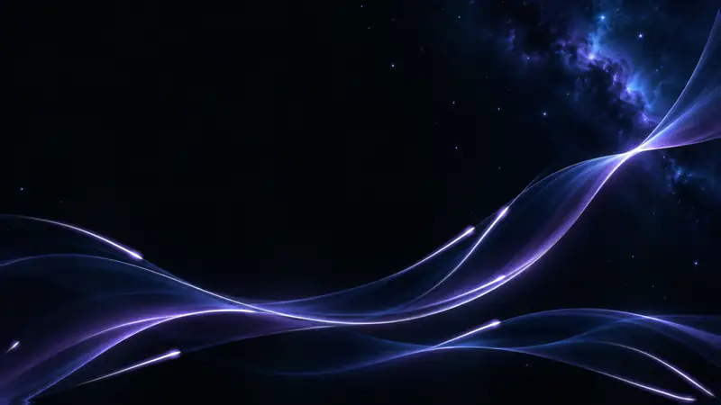
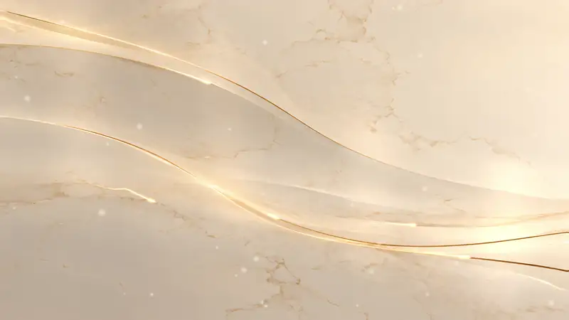
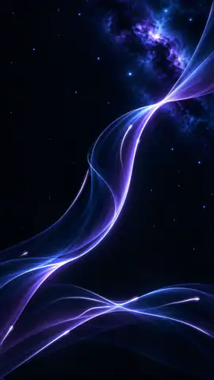
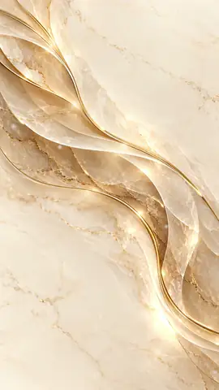

<div align="center">




# Flowing Light

**Two seamless animated backgrounds – in 4K and for phones.**<br>
Made to sit behind apps, games, menus, streams and desktops. Free for anything, commercial too.

[](LICENSE)
[](https://github.com/Lampe332/flowing-light-backgrounds/releases/latest)
[](https://github.com/Lampe332/flowing-light-backgrounds/releases/latest)


[](https://github.com/Lampe332/flowing-light-backgrounds/releases/download/v1.0/Flowing-Light-Backgrounds.zip)

[The backgrounds](#the-backgrounds) · [Files](#files) · [Use them](#use-them) · [Palette](#palette) · [License](#license)

</div>

---

## The backgrounds

Each background comes as a **live loop** (MP4) and a **still** (PNG + JPG), once in landscape 4K and once for
phones. The phone versions are composed for a tall screen – same look, same effects, laid out for portrait, not
cropped from the landscape ones.

<table>
<tr>
<td width="240" align="center">

</td>
<td>

### Cosmic Violet <sub>· dark</sub>

Violet silk ribbons drifting through deep space. Light pulses run along the ribbons, waves of light flow through
the silk, stars twinkle and shooting stars cross the sky.

Calm and dark enough for text and icons on top – use **white** text.

**Download**<br>
🎞️ Live loop: [4K](https://github.com/Lampe332/flowing-light-backgrounds/raw/main/Cosmic_Violet_Live_4K.mp4) · [Phone](https://github.com/Lampe332/flowing-light-backgrounds/raw/main/Cosmic_Violet_Live_Phone.mp4)<br>
🖼️ Still: 4K [JPG](https://github.com/Lampe332/flowing-light-backgrounds/raw/main/Cosmic_Violet_4K.jpg) / [PNG](https://github.com/Lampe332/flowing-light-backgrounds/raw/main/Cosmic_Violet_4K.png) · Phone [JPG](https://github.com/Lampe332/flowing-light-backgrounds/raw/main/Cosmic_Violet_Phone.jpg) / [PNG](https://github.com/Lampe332/flowing-light-backgrounds/raw/main/Cosmic_Violet_Phone.png)

</td>
</tr>
<tr>
<td>

### Marble Gold <sub>· light</sub>

Cream marble with sweeping layers and fine gold lines. Golden light runs along the lines, a soft sheen glides
over the polished stone and dust floats in the light.

Light and calm enough for text and icons on top – use **dark brown** text.

**Download**<br>
🎞️ Live loop: [4K](https://github.com/Lampe332/flowing-light-backgrounds/raw/main/Marble_Gold_Live_4K.mp4) · [Phone](https://github.com/Lampe332/flowing-light-backgrounds/raw/main/Marble_Gold_Live_Phone.mp4)<br>
🖼️ Still: 4K [JPG](https://github.com/Lampe332/flowing-light-backgrounds/raw/main/Marble_Gold_4K.jpg) / [PNG](https://github.com/Lampe332/flowing-light-backgrounds/raw/main/Marble_Gold_4K.png) · Phone [JPG](https://github.com/Lampe332/flowing-light-backgrounds/raw/main/Marble_Gold_Phone.jpg) / [PNG](https://github.com/Lampe332/flowing-light-backgrounds/raw/main/Marble_Gold_Phone.png)

</td>
<td width="240" align="center">

</td>
</tr>
</table>

<sub>The previews above are downscaled animated WebPs. The real files are full 4K / phone resolution.</sub>

## Files

All 12 files sit in the root of this repository. The [ZIP in the release](https://github.com/Lampe332/flowing-light-backgrounds/releases/latest)
contains all of them.

| | Size | Cosmic Violet | Marble Gold |
|---|---|---|---|
| 🎞️ **Live loop 4K** | 3840×2160 | [`Cosmic_Violet_Live_4K.mp4`](Cosmic_Violet_Live_4K.mp4) · 17.3 MB | [`Marble_Gold_Live_4K.mp4`](Marble_Gold_Live_4K.mp4) · 19.7 MB |
| 🎞️ **Live loop phone** | 2160×3840 | [`Cosmic_Violet_Live_Phone.mp4`](Cosmic_Violet_Live_Phone.mp4) · 19.3 MB | [`Marble_Gold_Live_Phone.mp4`](Marble_Gold_Live_Phone.mp4) · 23.1 MB |
| 🖼️ **Still 4K** | 3840×2160 | [`.png`](Cosmic_Violet_4K.png) 7.3 MB · [`.jpg`](Cosmic_Violet_4K.jpg) 1.3 MB | [`.png`](Marble_Gold_4K.png) 6.6 MB · [`.jpg`](Marble_Gold_4K.jpg) 1.2 MB |
| 🖼️ **Still phone** | 2160×3840 | [`.png`](Cosmic_Violet_Phone.png) 8.8 MB · [`.jpg`](Cosmic_Violet_Phone.jpg) 1.6 MB | [`.png`](Marble_Gold_Phone.png) 9.2 MB · [`.jpg`](Marble_Gold_Phone.jpg) 2.2 MB |

**Video specs:** H.264 (High), yuv420p, BT.709, 25 fps, 20 s (500 frames), no audio track.
**Seamless:** the last frame flows straight into the first – set the player to loop and there is no visible cut.
**Stills:** PNG is lossless, JPG is the light one for posting and the web.

## Use them

<details>
<summary><b>🌐 Website or web app</b> – full-screen video background with fallback</summary>

```html
<div class="bg">
  <video autoplay muted loop playsinline poster="Cosmic_Violet_4K.jpg">
    <source media="(orientation: portrait)" src="Cosmic_Violet_Live_Phone.mp4" type="video/mp4">
    <source src="Cosmic_Violet_Live_4K.mp4" type="video/mp4">
  </video>
</div>
```

```css
.bg {
  position: fixed;
  inset: 0;
  z-index: -1;
  background: #020508 url("Cosmic_Violet_4K.jpg") center / cover no-repeat;
}
.bg video {
  width: 100%;
  height: 100%;
  object-fit: cover;
}
/* Respect "reduce motion": show the still instead of the loop */
@media (prefers-reduced-motion: reduce) {
  .bg video { display: none; }
}
```

`muted` + `playsinline` are needed for autoplay on phones. For Marble Gold swap the file names and use
`#F9E5CA` as the fallback color.
</details>

<details>
<summary><b>🖥️ Desktop wallpaper</b> – Windows</summary>

- **Animated:** open the `*_Live_4K.mp4` in a video-wallpaper app such as
  [Lively Wallpaper](https://www.rocksdanister.com/lively/) (free) or Wallpaper Engine.
- **Still:** right-click the `*_4K.png` → *Set as desktop background*.
</details>

<details>
<summary><b>📱 Phone</b> – lock screen and home screen</summary>

- **Still:** set the `*_Phone.jpg` as wallpaper – it is already 9:16 and composed for portrait.
- **Animated:** use the `*_Live_Phone.mp4` with a video- or live-wallpaper app. On iPhone, convert it to a Live
  Photo first.
</details>

<details>
<summary><b>🎥 Streams</b> – OBS starting / BRB screens</summary>

Add a **Media Source**, pick the `*_Live_4K.mp4` and tick **Loop**. Text on top: white on Cosmic Violet, dark brown
on Marble Gold.
</details>

<details>
<summary><b>🎮 Game engines</b> – menus and title screens</summary>

- **Unity:** add a *Video Player* to the camera or a *Render Texture*, use the MP4 directly, enable *Loop*.
- **Godot 4:** `VideoStreamPlayer` plays Ogg Theora, so convert first. 1080p is plenty for a menu and much lighter to
  decode than 4K:

  ```sh
  ffmpeg -i Cosmic_Violet_Live_4K.mp4 -vf scale=1920:-2 -c:v libtheora -q:v 8 -an cosmic_violet.ogv
  ```
</details>

## Palette

Measured from the 4K stills – handy when you build a UI on top.

| | Base tones | Accents | Text on top |
|---|---|---|---|
| **Cosmic Violet** |    |    |  <sub>≥ 10.9 : 1 on the base tones</sub> |
| **Marble Gold** |    |    |  <sub>≥ 7.2 : 1 on the base tones</sub> |

<sub>Contrast ratios per WCAG 2. Over the brightest glow of the ribbons / gold lines contrast drops – keep text in
the calm areas or add a soft shadow.</sub>

## License

**[CC0 1.0 – Public Domain Dedication](LICENSE).** Use it for anything, commercial too: apps, games, videos,
streams, merch, templates. No credit needed, no permission needed.

Credit is welcome but optional:

```text
Flowing Light – Cosmic Violet / Marble Gold by Flowing Light Studio (CC0)
```

**How it was made:** the base images are AI-generated and upscaled to 4K; the animation – light pulses, waves,
stars, sheen, dust – was made in Blender.

**Also on:** DeviantArt – [Cosmic Violet](https://www.deviantart.com/wildelampe/art/Cosmic-Violet-%E2%80%93-Flowing-Light-1400364698)
· [Marble Gold](https://www.deviantart.com/wildelampe/art/Marble-Gold-%E2%80%93-Flowing-Light-1400365488)

<div align="center">
<br>
<sub>If you use Flowing Light somewhere, a ⭐ on this repo makes my day.</sub>
</div>
